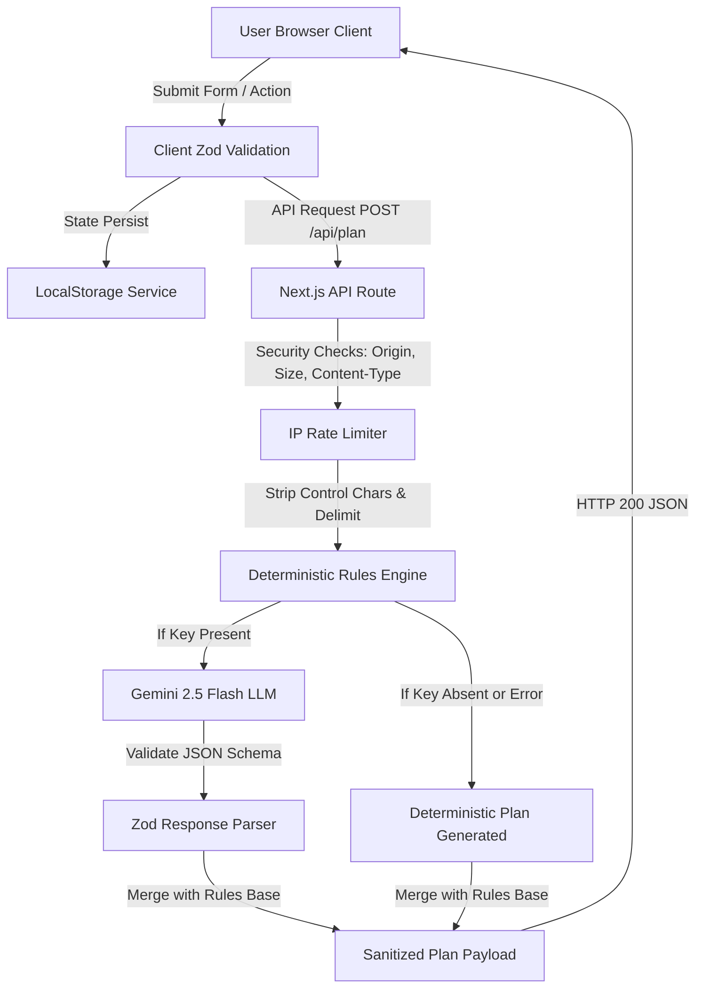

# Threat Model & Architecture (STRIDE Analysis)

## 1. Overview
Gatherly AI is a privacy-first, zero-account event planning system with hybrid deterministic rules + optional server-side Google Gemini 2.5 Flash enhancement.

## 2. STRIDE Categorization
- **Spoofing**: No user accounts or passwords are used. Client sessions exist solely in the browser's origin-scoped `localStorage`. API endpoints enforce Same-Origin verification on non-GET methods.
- **Tampering**: All inputs are validated through Zod schemas before being processed by the deterministic rules engine or the LLM. In-flight API payloads are validated both on request arrival and before response dispatch.
- **Repudiation**: State transitions (budget reallocation, event deletion, task completion) are logged to a client-side immutable activity timeline.
- **Information Disclosure**:
  - LLM API keys are exclusively server-side environment variables (`GEMINI_API_KEY`).
  - Guest personal details (names, contact numbers, specific dietary tags) are never packaged into AI prompt payloads.
  - Stack traces and internal error representations are caught and converted to standard `AppError` payloads.
- **Denial of Service**:
  - Rate limiting sliding-window per IP address (20 requests/minute).
  - Maximum JSON payload limit of 64KB on `/api/plan`.
  - AbortController timeout (8000ms) prevents hanging upstream model requests.
- **Elevation of Privilege**: Not applicable; architecture operates statelessly without administrative roles or privileged database tenants.

## 3. Data Flow Diagram

